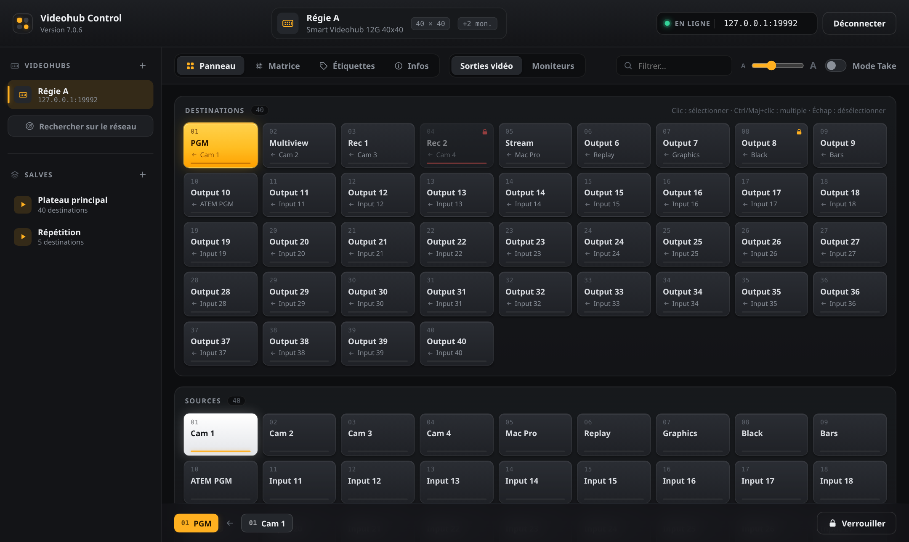
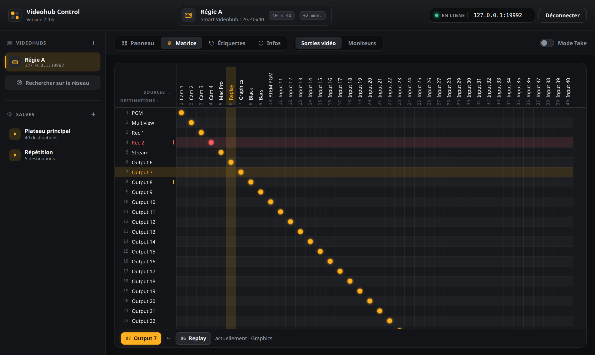

# Videohub Control (Linux)

Recréation de **Blackmagic Videohub Control 7.0.6** sous forme d'application web locale :
un petit serveur Python (aucune dépendance) parle au Videohub via le protocole Ethernet
Blackmagic (TCP 9990) et sert une interface dans le navigateur.



<details>
<summary>Vue matrice</summary>



</details>

## Deux versions, même interface

| | Application de bureau | Application web |
|---|---|---|
| Langage | Go | Python (aucune dépendance) |
| Fenêtre | native (GTK + WebKit) | navigateur, tablette incluse |
| Réseau | aucun serveur, aucun port ouvert | serveur HTTP local (port 8090) |
| Plusieurs postes | un poste | plusieurs navigateurs, synchronisés |

Les deux utilisent exactement la même interface (`videohub_control/web/`) et le même fichier
de configuration : favoris et salves sont partagés.

## Télécharger

Sur la page [Releases](https://github.com/primaultfrancois/Blackmagic-Videohub-Control/releases) :

- **Bureau** : `videohub-control-…-linux-amd64.tar.gz`, à décompresser puis `./videohub-control`.
  Nécessite WebKitGTK 4.1 (`libwebkit2gtk-4.1-0`, déjà présent sur Ubuntu desktop 24.04+).
- **Web** : `pip install videohub_control-…-py3-none-any.whl` puis `python3 -m videohub_control --open`.

Pour publier une nouvelle version : `git tag v1.0.0 && git push origin v1.0.0`. Le workflow
GitHub Actions teste, compile les deux versions et crée la release.

## Application de bureau (Go)

Dépendances de compilation (Ubuntu/Debian) :

```sh
sudo apt install golang-go libwebkit2gtk-4.1-dev
```

```sh
go build -o videohub-control ./cmd/videohub-control
./videohub-control                    # reconnecte le dernier Videohub utilisé
./videohub-control --hub 10.0.0.50    # connexion directe
```

Rien à installer : au premier lancement, le binaire s'ajoute de lui-même au menu des
applications avec son icône (et se met à jour s'il est déplacé). Pour le garder dans le dock :
clic droit sur l'icône → Épingler au dock. `--uninstall-desktop` retire le lanceur.

Le binaire embarque l'interface. À l'exécution il n'a besoin que de WebKitGTK
(`libwebkit2gtk-4.1-0`, présent sur les bureaux GNOME/Ubuntu). `--devtools` active l'inspecteur web.

## Application web (Python)

```sh
python3 -m videohub_control --open                 # http://localhost:8090
python3 -m videohub_control --hub 10.0.0.50        # connexion directe au démarrage
python3 -m videohub_control --bind 0.0.0.0         # accessible depuis le réseau (tablette…)
```

Python ≥ 3.10. Le dernier Videohub utilisé est reconnecté automatiquement au démarrage.

> `--bind 0.0.0.0` n'ajoute aucune authentification : toute personne ayant accès au port peut router.

## Fonctions

- **Panneau** : boutons Destinations / Sources. Sélectionner une destination met en évidence
  sa source ; cliquer une source route. Ctrl/Maj+clic pour router plusieurs destinations d'un coup.
- **Mode Take** : la source est armée (clignote) puis validée avec TAKE ou Entrée.
- **Verrous** : verrouiller / déverrouiller / forcer le déverrouillage (O / U / F du protocole).
- **Matrice** : grille de points de croisement, en-têtes fixes, adaptée jusqu'à 288×288.
- **Étiquettes** : édition des noms d'entrées, sorties et sorties moniteur, import/export CSV.
- **Salves** : mémoriser le routage (tout ou sélection) et le rappeler en un clic ; les sorties
  verrouillées par d'autres sont ignorées. Les salves sont liées à l'ID unique du Videohub.
- **Sorties moniteur** (Videohub qui en ont), **découverte réseau** (mDNS), favoris,
  reconnexion automatique, synchronisation temps réel entre plusieurs navigateurs.

Configuration : `~/.config/videohub-control/config.json`, partagée par les deux versions
(favoris et salves communs).

## Tests

```sh
go test ./...                               # nécessite libwebkit2gtk-4.1-dev pour internal/gui
python3 -m unittest discover -s tests -t .
```
